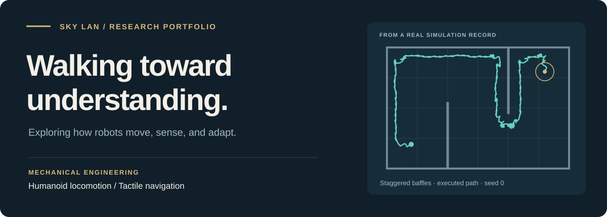
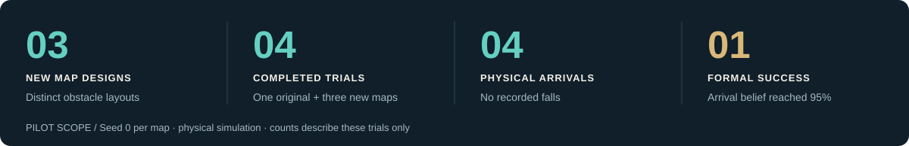
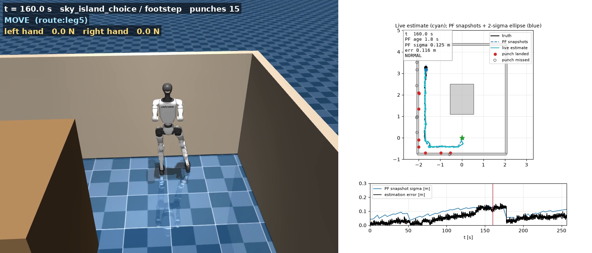
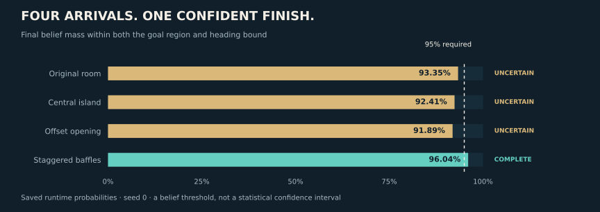
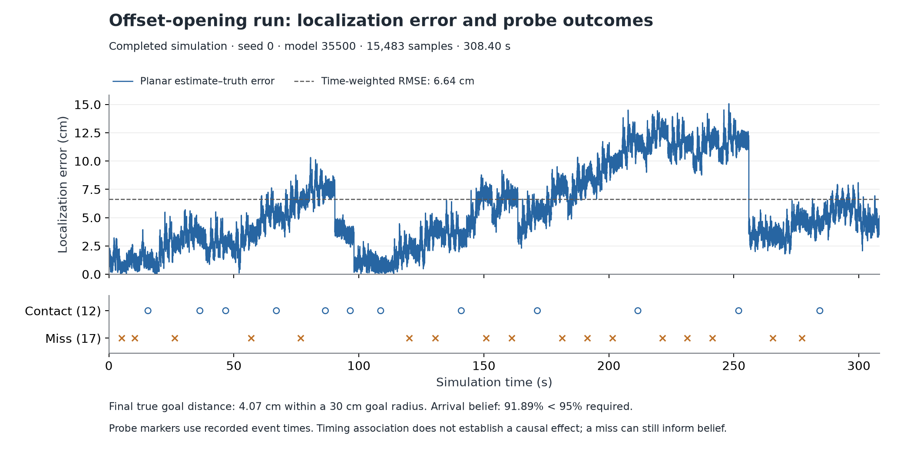

# Evaluating humanoid navigation on new maps



<p align="center">
  <strong>Humanoid robotics &nbsp;·&nbsp; Mechanical engineering &nbsp;·&nbsp; Research in simulation</strong><br>
  <sub>Shih-Kai Lan (Sky) · student team member · simulation research portfolio</sub>
</p>

<p align="center">
  <a href="docs/ADMISSIONS_RESEARCH_OVERVIEW.md"><strong>START HERE</strong></a> &nbsp; / &nbsp;
  <a href="docs/HOW_I_DIRECTED_AI.md"><strong>MY CONTRIBUTION</strong></a> &nbsp; / &nbsp;
  <a href="docs/RESEARCH_WALKTHROUGH.md"><strong>INSIDE THE RESEARCH</strong></a> &nbsp; / &nbsp;
  <a href="docs/VIDEOS.md">WATCH THE ROBOT</a> &nbsp; / &nbsp;
  <a href="docs/MY_RESEARCH_DIRECTION.md">WHY I CARE</a>
</p>

---

## The assignment and my role

A humanoid can reach a destination while its estimate of its own position remains uncertain. I participated as a student member of an ongoing Georgia Tech LIDAR research project, **under Professor Ye Zhao's mentorship and Zhenyu Wu's direct guidance**. My assigned contribution was to evaluate navigation on new maps: run the existing navigation system on a known map, then test it on new maps. Zhenyu and Huaze Liu shared guidance, code and reference work; the team had already developed the controller and navigation framework. [The dated assignment record →](docs/MENTOR_ALIGNMENT.md)

Before this assignment, I set up and trained a preliminary G1 simulation model with AI assistance, preserving its configuration, log and checkpoint.

I worked with the group on how to judge training and experiments, shared a weekly report, and turned Zhenyu's instructions into a documented baseline and new-map study. I directed AI tools to help implement and run the tests, used the resulting records to calculate and examine metrics, and shaped the analysis and report through follow-up questions. This was my assigned evaluation within a larger team effort; the tools expanded what I could do while learning. [My work and its supporting record →](docs/HOW_I_DIRECTED_AI.md)

**The question that emerged:** a robot can physically enter its goal region without the navigation system having enough confidence to certify arrival. This portfolio examines that gap through the recorded trials; it does not claim a general robustness result from four single-seed runs.

## Why this research matters

I want to contribute to a future in which robots can help people with everyday physical tasks and take on work in places that are difficult or dangerous to reach. Possible applications include carrying supplies through buildings and assisting with inspections in hazardous environments. For that future to be useful, robots need to move through different layouts and recognize when their own position estimates are uncertain. This is why I am interested in navigation research: under my mentors' guidance, I can contribute to testing a small but necessary part of that larger goal. The current work is a simulation pilot toward that ambition.

[The future contribution that motivates this work →](docs/ADMISSIONS_RESEARCH_OVERVIEW.md#why-study-this)

## The completed navigation pilot



**The finding:** all four completed trials entered the physical goal region, but three ended with insufficient arrival confidence. That gap between motion and certainty is the research question worth pursuing.

[Read the accessible research overview →](docs/ADMISSIONS_RESEARCH_OVERVIEW.md)

## From code to movement

[](projects/tactile-navigation/out/sky_evaluation_20261003/new_maps_physics/footstep/sky_island_choice/seed_0/sky_island_choice_footstep_pf_global_s0.mp4)

<p align="center"><sub>Central-island experiment · actual recorded simulation · full replay linked above</sub></p>

<p align="center">
  <a href="docs/VIDEOS.md"><strong>Explore all four replays →</strong></a> &nbsp; · &nbsp;
  <a href="projects/tactile-navigation/outputs/sky_navigation_trajectories.png">Compare the executed paths →</a>
</p>

## What the results reveal



The threshold requires enough localization belief to satisfy **both position and heading**. It is an internal belief criterion. Each map was tested with one seed, so these observations are a pilot study rather than a general success-rate estimate.

[Methods and metric definitions →](docs/TECHNICAL_DEPTH.md) &nbsp; · &nbsp; [Full report and limitations →](projects/tactile-navigation/outputs/Sky%20Navigation%20Experiment%20Report.md)

## Who contributed what

| Contributor | Role across the work shown here |
| :--- | :--- |
| **Me — Shih-Kai Lan (Sky)** | As a student participant, set up and trained a preliminary G1 simulation model, joined team discussions and shared a weekly report. Under my mentors' guidance, I used AI tools to carry out my assigned navigation evaluation: test the team system on new maps, examine the recorded data, and shape the analysis and report. |
| **Professor Ye Zhao — research mentor** | Guidance on research direction, learning resources and a suitable opportunity within the team. |
| **Zhenyu Wu — direct mentor** | Assigned the navigation evaluation and provided practical instructions, setup guidance and research resources. |
| **Huaze Liu and the research team** | The existing navigation framework, trained controller, shared code and reference maps. |
| **AI tools I used** | Technical assistance with setup, map/script implementation, simulation operation, calculations, visualization and drafting. Codex performed substantial implementation and operation under my task direction. |

The new layouts, recordings and measurements extend the team's existing system. I used AI to bridge gaps in my experience as a student, while staying involved in the research questions, interpretation and communication; the team's foundation and the tools' substantial implementation help remain credited. [Detailed contribution and AI-use record →](CONTRIBUTIONS.md)

## Follow one recorded experiment

The system connects a known map, a global route, a learned walking controller, a particle-filter position estimate, and hand probes selected for information. A failed touch attempt can still constrain the estimate. Final completion then requires enough belief to satisfy position and heading together.



*One executed seed-0 trial, using the team checkpoint. The figure shows recorded localization error and probe outcomes; temporal association alone does not establish a probe's effect.*

The offset-opening robot ended **4.07 cm** from its goal but failed the 95% joint-arrival criterion. In everyday terms, it arrived physically, but its estimate of position and direction was not confident enough for the software to declare success. Comparing the video with these measurements makes the evaluation useful: it identifies a case the team can investigate further. See the [short interpretation and proposed follow-up](docs/ADMISSIONS_RESEARCH_OVERVIEW.md#reading-one-result-and-planning-the-next-test). The [complete walkthrough](docs/RESEARCH_WALKTHROUGH.md) follows that trial through the system diagram, map design, raw records, measurements, unanswered questions, and a controlled next experiment.

## The curiosity behind the work

At a 2024 Georgia Tech / CIC Asia Future Tech Forum event, I saw professors, university students and high-school students using engineering to contribute to the world. Seeing students close to my age participate made research feel possible for me.

> Watching a robot learn to walk felt like a parent watching a child take its first steps.

That connection between an input and a physical movement drew me toward mechanical engineering. I want to explore more adaptive walking, movement knowledge that can transfer between robots, and cleaner, more efficient use of energy.

[My story and the questions I want to pursue →](docs/MY_RESEARCH_DIRECTION.md)

## A growing research journey

### The work I had to rebuild

Before the new-map study, I used AI tools to learn how to set up a simulation environment and begin robot training. My computer later suffered an internal board failure, and I lost the training work on that machine. I suspected the workload might have contributed, but its cause was never established. On a better laptop, I used previous conversations and the context I could reconstruct to direct AI through rebuilding the environment and finding settings that better fit the available resources.

This setback is part of my personal account. The surviving records show training, checkpoints, and a separate later navigation restart; they do not establish the cause of the earlier hardware failure. Rebuilding the environment also did not mean recovering every lost file. The experience gives me a concrete engineering goal: make the process understandable, measurable, and recoverable.

[Read the setback, recovery, and lessons →](docs/SETBACK_AND_REBUILD.md)

<table>
<tr>
<td width="33%" valign="top">
<h3>01 · Locomotion</h3>
<p><strong>Independent G1 exploration</strong></p>
<p>Rough-terrain training and a custom command that guides the robot toward its environment origin.</p>
<p><a href="projects/independent-g1-rough-terrain/README.md">Code, model &amp; training record →</a></p>
</td>
<td width="33%" valign="top">
<h3>02 · Measurement</h3>
<p><strong>Tactile controller experiments</strong></p>
<p>Reward changes, training artifacts and an unfavorable foot-tracking result preserved for learning.</p>
<p><a href="projects/tactile-controller/RETROSPECTIVE.md">Experiment retrospective →</a></p>
</td>
<td width="33%" valign="top">
<h3>03 · Navigation</h3>
<p><strong>New maps, new questions</strong></p>
<p>Different obstacle layouts reveal the relationship between physical arrival and localization confidence.</p>
<p><a href="docs/ADMISSIONS_RESEARCH_OVERVIEW.md">Featured case study →</a></p>
</td>
</tr>
</table>

### Where the technical difficulty lies

The work raises questions beyond making a robot move. A map must mean the same thing to the planner and the simulator. A narrower foot-tracking reward needs a fair comparison before anyone can claim it helps. A robot that ends **4.07 cm** from its target can still fail the arrival-confidence test while another **4.16 cm** away passes. These examples connect geometry, learning, measurement, and uncertainty to specific evidence in the archive.

[Five technical challenges, their evidence, and the next experiments →](docs/TECHNICAL_DEPTH.md#five-challenges-behind-the-results)

## Turning ambition into experiments

| Next step | The question it can answer |
| :--- | :--- |
| **Repeat** · more seeds, matched budgets | Which findings persist beyond a single run? |
| **Explain** · inspect belief and contact records | What causes arrival uncertainty, and can final sensing help? |
| **Transfer** · another robot body or terrain | How much movement knowledge can be reused with less retraining? |
| **Measure** · energy alongside stability | What tradeoffs connect useful movement and energy consumption? |

Adaptive walking, broad transfer and cleaner energy are future directions. The current evidence establishes a simulation case study and a starting point for those questions.

[A concrete next study: repeated trials, paired sensing comparisons, and final-belief diagnostics →](docs/RESEARCH_WALKTHROUGH.md#what-a-stronger-next-study-would-test)

---

## Acknowledgments

I thank [Professor Ye Zhao](https://people.research.gatech.edu/ye-zhao) for his feedback, engineering advice and help finding a research direction. Zhenyu Wu gave me sustained practical guidance, setup help, instructions and access to the team's resources; he also introduced me to Huaze Liu, who generously shared maps and research work as references. Rui Yan, Feiyang and Junnosuke helped with early onboarding and evaluation questions. Their support made my participation possible. [Full credits →](CONTRIBUTIONS.md)

---

<details>
<summary><strong>Research evidence, limitations and application writing</strong></summary>

- [Full navigation report](projects/tactile-navigation/outputs/Sky%20Navigation%20Experiment%20Report.md) · [Numeric audit](projects/tactile-navigation/outputs/sky_validation.json) · [Video audit](projects/tactile-navigation/outputs/sky_video_validation.json)
- [Source inventory and hashes](SOURCE_MANIFEST.json) · [Source revisions](PROVENANCE.json) · [Graphic sources](assets/SOURCES.md)
- [Portfolio review and sharing caveats](docs/PORTFOLIO_REVIEW.md) · [Repeatable content audit](presentation/audit_portfolio.py)
- [Historical application-writing guide (October 3; see the current contribution record above)](projects/tactile-navigation/outputs/College%20Admission%20Research%20Writing%20Guide.md)
- Scope: one seed per map, simulation only, team model 35500 substituted for the missing default 34000. The original room and new maps had different time caps; the system-interrupted attempt remains separate.
- The earlier controller screening did not demonstrate improvement. The independent G1 package does not establish guaranteed fall prevention or energy-efficiency gains.

</details>

<details>
<summary><strong>Private archive and reproduction</strong></summary>

This repository preserves source snapshots, models, datasets, logs, reports and recordings. Large artifacts use Git LFS:

```bash
git clone https://github.com/ShihkaiLan1008/gatech-lidar-research-assistant.git research-retrospective
cd research-retrospective
git lfs pull
```

Dependencies and original local paths are documented by project. The archive is private and read-only; authorized updates require unarchiving it. Admissions readers need an approved excerpt or explicitly granted access. [Confidentiality and access →](CONFIDENTIALITY.md)

</details>

<p align="center"><sub>Ask a question. Build an experiment. Keep the evidence. Continue learning.</sub></p>
