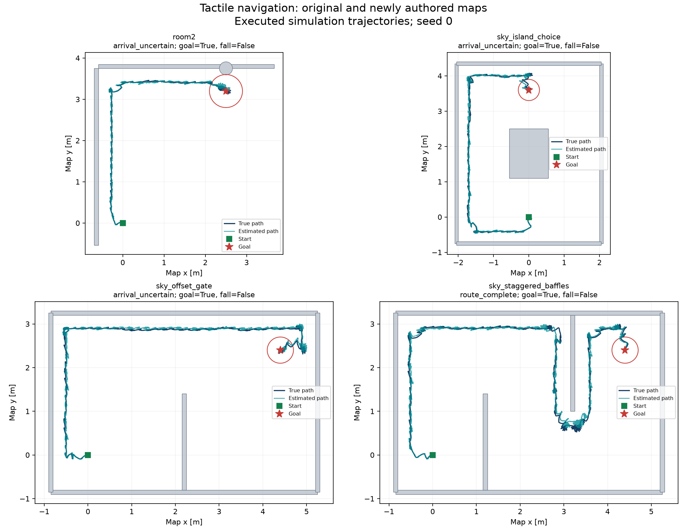

[← Portfolio home](../README.md) · [Research overview](ADMISSIONS_RESEARCH_OVERVIEW.md) · [Technical depth](TECHNICAL_DEPTH.md) · [Video gallery](VIDEOS.md)

# Can a humanoid know when it has arrived?

In plain terms, I tested whether the team's robot could navigate new layouts and whether its software could tell when it had reached the goal.

## Assignment, research question and my role

I participated as a student member of an ongoing Georgia Tech LIDAR research project under Professor Ye Zhao's mentorship and Zhenyu Wu's direct guidance. Zhenyu assigned me the navigation evaluation presented here. The task was to run the existing navigation system with visible evidence, then test it on new maps to explore generality and robustness. The team had already built the humanoid controller, planner, localization and touch-sensing framework; Huaze Liu shared maps and research work as references. [Dated task record →](MENTOR_ALIGNMENT.md)

I discussed training and evaluation with the group, shared a weekly report, and organized the assigned study into an existing-map run and three new-map tests. I directed AI tools to help with map code, geometry checks, simulation runs and calculations; I worked through the saved recordings and metrics to examine final distance, arrival confidence and the limits of each comparison. I shaped the report around the research question. When a run was interrupted by a computer restart, I requested investigation and continuation and decided when to pause and resume. [My work and dated evidence →](HOW_I_DIRECTED_AI.md)

The resulting question is whether physical arrival and confidence in arrival agree. In four completed single-seed simulations, the robot entered the goal region each time, but the navigation system formally confirmed arrival only once. My role was to contribute to this mentor-guided evaluation, using AI as a substantial technical aid and directing its use for my assigned tasks. The underlying algorithms and trained navigation model remain team work. [Detailed attribution →](../CONTRIBUTIONS.md)

Earlier, I set up and trained a preliminary G1 simulation model with AI assistance and preserved its configuration, log and checkpoint. The independent rough-terrain package and later foot-tracking work were separate stages of my participation; they did not constitute this new-map assignment. The three new layouts were deliberately authored cases, not a randomized or repeated robustness benchmark. [Research timeline →](MENTOR_ALIGNMENT.md) · [Setback and rebuild →](SETBACK_AND_REBUILD.md)

## What was changed and why

The offset-opening map forces an indirect route through an opening at one end of a divider. The staggered-baffle map adds repeated turns around alternating dividers. The island map presents two possible routes around a central solid obstacle and exercises the map-coordinate transformation with a different starting heading.

These layouts introduce different navigation demands while leaving the underlying controller and navigation settings shared. Twelve focused checks passed for loading, endpoints, clearance and obstacle representation. All three planned routes passed the framework's feasibility checks; actual physical-simulation execution was assessed separately.

## What the experiments showed

| Layout | Physical goal reached | Fell | Formal completion | Final distance to goal | Arrival belief |
|---|---|---|---|---:|---:|
| Original room2 | Yes | No | Arrival uncertain | 7.31 cm | 93.35% |
| Central island | Yes | No | Arrival uncertain | 6.41 cm | 92.41% |
| Offset opening | Yes | No | Arrival uncertain | 4.07 cm | 91.89% |
| Staggered dividers | Yes | No | Route complete | 4.16 cm | 96.04% |

The system requires at least 95% of its localization belief to satisfy both final position and heading conditions before declaring arrival. The simulator's true final position was inside the goal region in all four trials; that ground truth was used to evaluate execution. Three internal beliefs remained insufficiently confident. The distinction exposes a meaningful research question about how sensing, uncertainty and completion interact.

A more complicated-looking map did not necessarily produce a worse completion outcome. One trial per layout cannot explain why the staggered map passed or establish which geometry is easier. Contact count alone also does not establish that more touches cause higher confidence.

*True and estimated trajectories from the four completed seed-0 trials. Axes are in metres; obstacles and goal disks are shown. These are executed simulation records.*

## Reading one result and planning the next test

For my assigned evaluation, I compared physical movement with the system's recorded completion decision. The offset-opening trial ended 4.07 cm from the goal, inside the allowed 30 cm radius, but its joint arrival belief was 91.89%, below the required 95%. The staggered-dividers trial ended slightly farther away, at 4.16 cm, and passed with 96.04% belief. Distance alone therefore does not explain the different completion outcomes: the system also evaluates uncertainty in position and heading.

This comparison gives the team a concrete case to investigate. The saved maps, videos and measurements make it possible to inspect where physical arrival and the software's completion decision diverged. My contribution was to help carry the assigned testing through to this documented evaluation, working with the team's system and AI tools under my mentors' guidance. The current records do not isolate which source of uncertainty caused the offset-opening result.

A follow-up I would discuss with my mentors is to repeat the offset-opening case with five predefined random seeds and a consistent time limit, keeping the controller and scoring rules fixed. Recording position, heading and joint arrival confidence separately would help identify which condition prevents completion. A later comparison could test whether a different sensing strategy improves confirmation under the same conditions. These are proposed experiments; the portfolio reports the completed pilot only.

## What the work can do now

It can serve as a new-map evaluation suite and a reproducible diagnostic case study. The saved maps, recordings, contact events and metric definitions let a researcher examine how the same framework behaves on different layouts. Replay videos show the executed behavior rather than a hand-animated successful route.

Potential longer-term value is better navigation when position estimates drift or sensing is uncertain. Application to dark spaces, visually difficult environments or assistive robots would require further evidence; it is not demonstrated by these trials.

## The difficult questions underneath the demonstration

[Inside the research](RESEARCH_WALKTHROUGH.md) explains the system as a whole and opens one recorded trial, including the timeline of error, contacts, and misses. It also gives a concrete plan for a controlled next comparison.

Three examples show why this work goes beyond drawing a room and playing a robot animation:

- **Geometry must agree across systems.** The island map's authored start heading is rotated into the navigation frame. Its goal changes from an authored displacement of `(3.6, 0)` to `(0, 3.6)`. The planner and simulated obstacles must still represent the same room.
- **A plausible training idea can fail to establish improvement.** Earlier work added a narrower foot-position reward, but later screening measured 33.02 cm error for the tuned checkpoint versus 9.62 cm for the reference. Different training histories prevent a causal conclusion about the reward; a matched experiment is needed.
- **Closeness is not certainty.** The offset-opening robot finished slightly closer to its goal than the staggered-baffle robot, yet only the latter passed the joint position-and-heading belief threshold. The next question is what evidence the system lacked, rather than whether the final video looked successful.

[Technical depth](TECHNICAL_DEPTH.md) explains the mechanisms, measurements, source evidence, and controlled follow-up experiments. These explanations were developed with AI assistance; the team supplied the underlying methods.

## What it has taught at the project level

Useful robotics results include unsuccessful criteria and uncertainty, not just an appealing video. Here, a robot can finish close to its target while the system still declines to certify arrival. A careful evaluation separates geometry feasibility, physical movement, localization accuracy and confidence. It also preserves an unfavorable earlier foot-tracking result rather than reporting improvement without support.

Sky describes a 2024 forum experience as the origin of their interest in mechanical engineering, and the sight of robot movement emerging from changed inputs as a source of excitement. Their longer-term interests are more adaptive walking, transferable robot knowledge and cleaner energy. [Personal motivation and research path](MY_RESEARCH_DIRECTION.md) connects those interests to concrete next experiments while keeping untested ambitions distinct from results.

## Limits and next questions

Only one seed was run per layout, all trials were simulation, and a team model-35500 checkpoint replaced the absent README default model 34000. The original map had a 240 s cap while new maps had 900 s caps. A Windows-interrupted attempt was recorded separately and restarted; it is not counted as an extra independent completed trial. These are pilot observations, not a population success-rate estimate or an exact replication of the team's default experiments.

The next study should match budgets and repeat seeds before making robustness claims. Then vary opening widths, compare sensing policies or final confirmation probes, and inspect whether confidence improvements also remain calibrated against simulator truth. Real-hardware transfer is a future team research step.

For mathematical definitions and the particle-filter/planner/controller relationship, see [Technical depth](TECHNICAL_DEPTH.md). For records, exact settings, checkpoint identity and hashes, see the [full experiment report](../projects/tactile-navigation/outputs/Sky%20Navigation%20Experiment%20Report.md).

## Acknowledgments

I thank [Professor Ye Zhao](https://people.research.gatech.edu/ye-zhao) for his feedback and help finding a suitable research direction. Zhenyu Wu provided sustained practical mentorship, instructions, setup help and research resources. Huaze Liu generously shared maps and research work as references. I also appreciate the early guidance of Rui Yan, Feiyang and Junnosuke. [Full credits and contribution boundaries →](../CONTRIBUTIONS.md)
