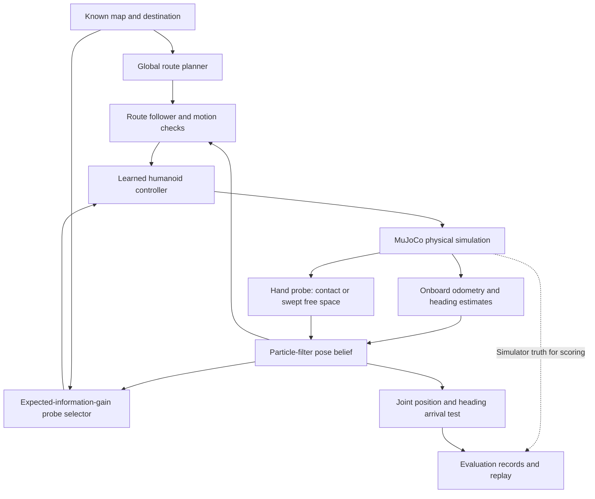

[← Portfolio home](../README.md) · [My contribution](HOW_I_DIRECTED_AI.md) · [Team assignment](MENTOR_ALIGNMENT.md) · [Technical definitions](TECHNICAL_DEPTH.md) · [Videos](VIDEOS.md)

# Inside the research: from a map to a defensible result

The team's question is how a humanoid can navigate while its estimate of its own position drifts, using touch to obtain information about its surroundings. Sky's assigned extension was to test that existing framework on new simulated maps. The resulting pilot exposed a useful distinction: a robot may be physically inside the goal while its internal belief remains too uncertain to certify arrival.

This walkthrough connects the research idea, the implemented system, and one preserved trial. It explains team methods and AI-assisted evaluation; the underlying methods remain credited to the team.

## The three stages belong to one developing interest

| Stage | Question | Work preserved | What it established |
| :--- | :--- | :--- | :--- |
| **Learning locomotion** | Can I set up a simulation, train a policy, and inspect its behavior? | Independent G1 code, configuration, logs, checkpoint | A learning and engineering artifact; no verified energy-efficiency result |
| **Testing tracking precision** | Could a narrower foot-position reward improve reference tracking? | Reward change, training outputs, later screening | The screening did not establish improvement; unmatched training histories limit causal interpretation |
| **Evaluating navigation** | Does the team's controller/planner/localizer still work on different layouts? | Three new maps, geometry checks, executed runs and videos | New-map pilot results, including a gap between physical arrival and formal completion |

The link between these stages is the problem of judging useful movement: what was commanded, what physically happened, and what evidence supports a success claim? The [Slack-based source record](MENTOR_ALIGNMENT.md) documents how the actual assignments changed. The current navigation experiments reused a team-trained controller; the locally trained foot-tracking checkpoint was not the controller evaluated here.

## What is inside the navigation system?

**The map is supplied.** This study does not demonstrate discovering an unknown map. The initial pose has a specified prior, and the estimator tracks uncertainty as movement accumulates. The high-level estimate does not receive simulator-truth position; truth is retained separately for scoring.

**The controller makes commands physically executable.** The controller repository describes separate upper- and lower-body policies for a 29-joint G1, with hand-target and footstep commands. Those learned policies are the team's foundation. Navigation must also respect reach, geometry, heading, and execution constraints; a path drawn through free space is not enough to establish that the humanoid executed it.

**The global route and the probe selector have different jobs.** The route determines movement targets. Expected information gain (EIG) selects sensing actions. The selector evaluates a candidate hand/angle using modeled contact and miss outcomes, weighted by their predicted probabilities, and accounts for whether a probe is worth its time. An uninformative or unreachable touch is not automatically useful.

**Touch helps only with the uncertainty it can observe.** The localizer's model uses a contact to constrain position relative to a surface. A single flat-wall contact leaves other directions weakly constrained; paired contacts can provide heading information under the model's conditions. A completed miss can also rule out poses that predicted a wall along the swept path. Therefore, contact count alone does not measure localization quality, and a miss is not automatically wasted information.

**The 0.18 m execution setting is a sensing trigger, not a universal guarantee.** Under the recorded `probe_then_continue` policy, bounded sensing can be followed by a movement primitive even if positional uncertainty remains above the trigger; geometry and yaw checks still apply. The final arrival test has its own criterion. Conflating these rules would overstate what the framework guarantees.

The offset-opening record reports zero accepted positional exceedances. The configured ability to continue above the trigger is a policy property, not an event observed in that trial.

Source entry points: [team README](../projects/tactile-navigation/README.md), [controller architecture](../projects/tactile-controller/README.md), [route and probe selection](../projects/tactile-navigation/src/execution/global_route.py), [pose estimator](../projects/tactile-navigation/src/execution/punch_belief.py), and [execution policy](../projects/tactile-navigation/docs/UNCERTAINTY_EXECUTION.md).

## Why these maps are meaningful tests

| New layout | Intended challenge | What must remain valid before interpreting a run |
| :--- | :--- | :--- |
| [Central island](../projects/tactile-navigation/maps/sky_island_choice.json) | Alternatives around an obstacle; a different authored initial heading | Coordinate transforms must preserve the relationship among start, goal, obstacles, and simulated contact bodies |
| [Offset opening](../projects/tactile-navigation/maps/sky_offset_gate.json) | An indirect passage through a divider | The planned clearance and the physical room must agree |
| [Staggered dividers](../projects/tactile-navigation/maps/sky_staggered_baffles.json) | Repeated changes of direction and contact opportunities | Feasible turns and sensing opportunities must translate into executed behavior |

These are deliberately authored cases, not a random sample of environments. Geometry checks validate selected invariants. Physical execution and localization then test a different layer. Map difficulty cannot be ranked reliably from one run per map.

## Open one experiment: the offset-opening run

The completed restart trial used `sky_offset_gate`, seed 0, and the same team checkpoint `35500` used throughout this pilot. The earlier interrupted attempt remains separate. Start with the [map](../projects/tactile-navigation/maps/sky_offset_gate.json), [video](../projects/tactile-navigation/out/sky_evaluation_20261003/new_maps_physics_restart/footstep/sky_offset_gate/seed_0/sky_offset_gate_footstep_pf_global_s0.mp4), and [raw evaluation record](../projects/tactile-navigation/out/sky_evaluation_20261003/new_maps_physics_restart/footstep/sky_offset_gate/seed_0/sky_offset_gate_footstep_pf_global_s0.eval.json).

*Every one of the 15,483 recorded samples is plotted. The lower strip marks recorded probe-event times: 12 contacts and 17 completed misses. The figure is a descriptive view of one saved trial, not proof that a nearby probe caused a change in error. Generated from existing data; no new simulation was run.*

| Check | Measured result | Interpretation |
| :--- | :--- | :--- |
| Planned route | 9.80 m; belief-A* fallback produced a feasible route | The initial seed/refine strategy used its fallback; the log exposes which planner actually supplied the route |
| Elapsed simulation time | 308.40 s | Includes the executed task, not just net progress toward the goal |
| Recorded planar path length | 24.36 m | Accumulated true planar motion; not shortest-path distance or an efficiency score |
| Probe attempts | 29: 12 contacts, 17 completed misses | Contact opportunities and actual outcomes differ |
| Time-weighted localization RMSE | 6.64 cm | Error in estimated position throughout the run; not foot-placement error |
| Final true distance to goal | 4.07 cm within a 30 cm goal radius | Physical arrival occurred |
| Final joint arrival belief | 91.89%, below the required 95% | The framework ended with `arrival_uncertain` |
| Recorded fall | No | Necessary context, but not sufficient for formal completion |

The first two probes were completed misses at 5.14 s and 10.40 s. This illustrates why a run needs event records rather than only a final screenshot. It does not establish that those misses caused the final uncertain arrival. The full [results](../projects/tactile-navigation/outputs/sky_results.json), [independent metric audit](../projects/tactile-navigation/outputs/sky_validation.json), and [new trace audit](../presentation/navigation_trace_audit.json) make the numbers traceable.

The [run log](../projects/tactile-navigation/out/sky_evaluation_20261003/new_maps_physics_restart/footstep/sky_offset_gate/seed_0/run.log) also records that the requested `seed_refine` planner used a `belief_astar` fallback. The planned 9.80 m route and recorded 24.36 m planar trajectory are different quantities. Their difference calls for inspecting executed motion and recovery events; it alone neither identifies the cause nor establishes an efficiency comparison against another policy.

The staggered-dividers trial provides a counterexample to judging success by final distance alone: it ended 4.16 cm from its goal, slightly farther away, but passed with 96.04% joint arrival belief. Different belief distributions can matter even when final physical errors look similar. These two runs do not isolate which map feature caused the difference.

## What the pilot answers, and what it leaves unresolved

The pilot shows that this specific team framework and checkpoint could physically reach the goal in four completed simulated trials, including the three new layouts. It also identifies three trials in which the framework withheld formal completion. That is a useful diagnostic case study, not an estimate of a deployment success rate.

The remaining question is not answered by the four headline numbers: **which uncertainty prevented arrival certification, and which sensing action would resolve it reliably?** Possible explanations include position spread, heading spread, contact geometry, missed observations, and estimator-model assumptions. These are competing hypotheses, not diagnoses established by this pilot.

The saved evaluation samples contain pose estimates and simulator truth, not a full particle cloud at every instant. The current figure therefore cannot reconstruct the entire time history of joint arrival mass or separate every cause of uncertain belief. A deeper follow-up should record the needed intermediate quantities explicitly.

## What a stronger next study would test

*Proposed work; not yet executed.*

| Test | Keep fixed | Change or record | Evidence it would add |
| :--- | :--- | :--- | :--- |
| **Replicate one difficult case first** | Offset map, checkpoint, runtime settings, scoring, and time cap | Five predefined seeds; sequential runs | Whether the seed-0 behavior recurs, with counts and uncertainty rather than a blanket robustness claim |
| **Test the sensing policy** | Same map, paired seeds, checkpoint, and budget | Full EIG pipeline versus the existing `random_touch` preset | A controlled comparison of completion, localization, probe cost, time, and falls; not simply which video looks better |
| **Diagnose the final guard** | The original 95% completion requirement | Log position mass, yaw mass, joint mass, and probe context before/after final sensing | Which requirement remains unsatisfied and whether confidence agrees with simulator truth |
| **Vary geometry systematically** | The controller and all non-geometric settings | A predefined opening-width series or seeded map generator, with geometry validation | A more interpretable test of generality than three unrelated layouts alone |

The repository already defines [baseline presets](../projects/tactile-navigation/README.md#module-swaps-and-ablations); their existence is not evidence that this portfolio ran them. Complete the small matched comparison before expanding the campaign. Preserve interrupted attempts and failures, and separate any operating-system interruption from an algorithmic failure.

For Sky, the next opportunity is to state a prediction before the comparison, explain why the held-fixed variables matter, and interpret an unfavorable result in his own words. That would add direct evidence of developing experimental judgment to the initiative and follow-through already visible in the mentor conversations.

## Follow the evidence without searching thousands of files

| Reader wants to inspect… | Open this |
| :--- | :--- |
| The mentor's actual assignment and how it evolved | [Mentor alignment](MENTOR_ALIGNMENT.md) |
| The student's decisions and participation | [My contribution](HOW_I_DIRECTED_AI.md) |
| The map-to-simulator validity checks | [Map tests](../projects/tactile-navigation/tests/demo_map/test_sky_maps.py) |
| The stopping rule | [Arrival guard](../projects/tactile-navigation/src/execution/route_guard.py) |
| Metric calculation from raw samples | [Validation script](../projects/tactile-navigation/scripts/sky_validate_results.py) |
| The new time plot and its reproducibility | [Plot source](../presentation/build_navigation_trace.py) and [audit](../presentation/navigation_trace_audit.json) |
| Full parameter choices, recovery and deviations | [Experiment report](../projects/tactile-navigation/outputs/Sky%20Navigation%20Experiment%20Report.md) |

The study remains simulation-only, with one completed seed per layout, different original/new-map time caps, and a substituted available checkpoint. [Technical definitions](TECHNICAL_DEPTH.md) and [contribution boundaries](../CONTRIBUTIONS.md) accompany every deeper interpretation.
