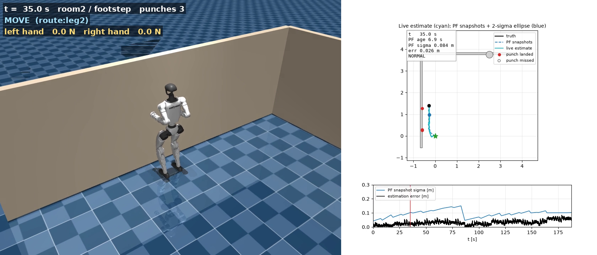

[← Portfolio home](../README.md) · [Research overview](ADMISSIONS_RESEARCH_OVERVIEW.md) · [Technical depth](TECHNICAL_DEPTH.md) · [Video gallery](VIDEOS.md)

# The experiments, in motion

Videos replay saved executed robot states with a trajectory/localization panel. They are simulation evidence; no real robot is shown. All four files were decoded completely and start/middle/end frames visually checked. Walls occasionally occlude the robot; the plot panel helps track the motion.

[Read one run alongside its map, measurements, and sensing events →](RESEARCH_WALKTHROUGH.md#open-one-experiment-the-offset-opening-run)

## A glimpse of the recorded runs

| Original room | Central island |
| :---: | :---: |
|  |  |

## Full recordings

| Run | Replay | Outcome |
|---|---|---|
| Original room2 | [Full video](../projects/tactile-navigation/out/sky_evaluation_20261003/original_room2/footstep/room2/seed_0/room2_footstep_pf_global_s0.mp4) | Arrival uncertain |
| Central island | [Full video](../projects/tactile-navigation/out/sky_evaluation_20261003/new_maps_physics/footstep/sky_island_choice/seed_0/sky_island_choice_footstep_pf_global_s0.mp4) | Arrival uncertain |
| Offset opening | [Full video](../projects/tactile-navigation/out/sky_evaluation_20261003/new_maps_physics_restart/footstep/sky_offset_gate/seed_0/sky_offset_gate_footstep_pf_global_s0.mp4) | Arrival uncertain |
| Staggered dividers | [Full video](../projects/tactile-navigation/out/sky_evaluation_20261003/new_maps_physics_restart/footstep/sky_staggered_baffles/seed_0/sky_staggered_baffles_footstep_pf_global_s0.mp4) | Route complete |

Download with `git lfs pull` when viewing a local clone. See the [video integrity audit](../projects/tactile-navigation/outputs/sky_video_validation.json) and [trajectory figure](../projects/tactile-navigation/outputs/sky_navigation_trajectories.png).
