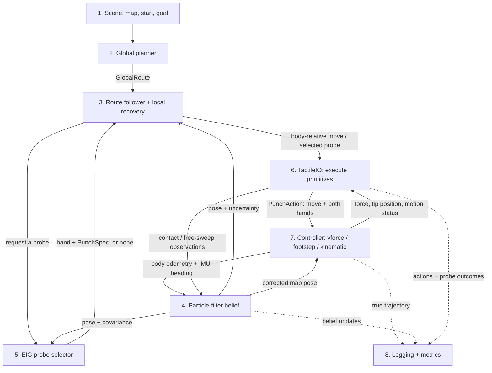

# Demo pipeline: modules and interfaces

Checked 2026-09-11 on `jjang318/punch+global`, for
`scripts/punch_demo.py --policy global`. This is the current implementation;
controller alternatives are listed below. Module boxes are responsibilities, not
necessarily separate files or replaceable plugins.



The complete feedback loop applies to **vforce, footstep and kinematic**.
Footstep uses the upstream position generator through estimated foot/heading feedback.
Scene geometry also feeds the PF observation model, probe selector and controller
environment. Dashed arrows are observation for evaluation; logging sends no commands.

| Module | Consumes → produces | Current implementation / alternatives | Code reference |
| --- | --- | --- | --- |
| **1. Scene** | Room name + standoff → analytic map, scene geometry, map-frame start/heading and goal disk | Registry: `room2`, `room2_turn`, `demo_room`, `room830`, four `ref*` rooms; authored JSON and scan/preset loaders | [`load_demo_scene`, `DEMO_ROOMS`](../src/execution/demo_scenes.py), [`build_manifest_scene`](../src/demo_map/manifest.py) |
| **2. Global planner** | Map + start/goal + initial pose covariance + motion/contact model + bounds → `GlobalRoute` | `plan_grid` is the wired search. Objective choices: `free_distance_then_distance_and_rotation` (default), `distance_and_rotation`. These are costs of the same planner. | [`plan_global`, `GlobalRoute`](../src/execution/global_route.py), [`plan_grid`](../src/lane_graph/grid_constrained.py) |
| **3. Local execution** | Route + current PF belief + primitive outcomes → next relative displacement, heading, probe request, route progress | `RouteFollowPolicy`; `BeliefRouteGuard` checks arrival/departure; `local_connector` reconnects to the fixed route. `--route-guard belief/contact/distance` changes transition checks. | [`RouteFollowPolicy._goto`, `.step_station`](../src/execution/global_route.py), [`BeliefRouteGuard`, `local_connector`](../src/execution/route_guard.py) |
| **4. Localization** | Body odometry + IMU heading + contact/miss geometry + map → weighted pose particles, mean, 3×3 covariance, controller correction | `PunchLocalizer` with particle filter. Global mode requires PF; `--estimator none` is only an alternative for legacy policies. | [`PunchLocalizer.predict`, `.observe`, `.pose`, `.cov3`](../src/execution/punch_belief.py) |
| **5. Probe selection** | Map + current pose/covariance + reach limits + optional uncertainty projection → hand, angle/`PunchSpec`, predicted gain, or no probe | `SingleTouchSelector` using EIG. It searches both hands; the route does not prescribe the exact hit point. No movement is selected by EIG in global mode. | [`SingleTouchSelector.choose_single`](../src/execution/global_route.py), [`ArmAngleEIG`, `spec_at`](../src/execution/punch_eig.py) |
| **6. Primitive execution** | Relative move or `PunchSpec` + controller feedback → per-tick `PunchAction`, completion status, contact/free-sweep observation | Shared `TactileIO`; owns move waiting and probe approach/hold/retraction. No alternative primitive executor is registered. | [`TactileIO.move`, `.punch`, `._tick`](../src/execution/punch_rules.py), [`MoveCmd`, `HandCmd`, `PunchAction`](../src/execution/punch_actions.py) |
| **7. Controller + simulated robot** | `PunchAction` + onboard state → physical motion, hand readings, motion status and odometry; truth separately for scoring | `--controller vforce`, `footstep`, `kinematic`; details and readiness below | [`PunchController`, `CONTROLLERS`, `make_controller`](../src/execution/controllers.py) |
| **8. Evaluation** | Timestamped estimated/true poses + events + probe outcomes + goal/outcome → `.eval.json`, replay records, summary JSON/CSV | Shared `DemoRunLog` → `RunRecorder`; independent metric functions. Controller-specific reads stay in the adapter. | [`DemoRunLog`](../src/execution/demo_logging.py), [`RunRecorder`, `compute_metrics`](../src/execution/evaluation.py), [`punch_eval.py`](../scripts/punch_eval.py) |

## Controller candidates

| Candidate | How a base target becomes motion | Hands | Current status / source |
| --- | --- | --- | --- |
| **`vforce`** | Estimated pose error → body velocity command → learned lower-body policy → MuJoCo/MJWarp | Pose/anchor + contact intent and force command → learned upper-body policy | Global/PF loop connected. [`VForcePunchController`](../src/execution/punch_vforce.py), [`EstimatedPoseTwistCommand`](../src/execution/estimated_twist.py), [`VForceBackend`](../src/execution/vforce_backend.py) |
| **`footstep`** | FK/IMU leg odometry + PF → estimated footstep geometry → seven-value command → learned lower-body actor → MuJoCo/MJWarp | Pelvis-frame pose + measured FK pose/error → learned upper-body actor; no arm-anchor or force-command inputs | Execution uses no simulator pose/velocity. Checkpoint `models/0911_footmimic_noforce/model_34000.pt`. [`FootstepPunchController`](../src/execution/punch_footstep.py), [`EstimatedPositionFootstepCommand`](../src/execution/estimated_footstep.py) |
| **`kinematic`** | Estimated pose error → analytic base motion with configured tracking/odometry errors | Geometric hand motion/contact | Global/PF loop connected; CPU, no learned locomotion or physics. [`KinematicPunchController`](../src/execution/punch_kinematic.py) |

The footstep execution path is:

```text
noisy/delayed encoders + gyro + accelerometer
  -> ImuTilt + ProprioceptiveFK
  -> LegOdometry (stance-foot displacement, gyro yaw)
  -> PF correction -> estimated pose/feet
  -> EstimatedPositionFootstepCommand -> lower actor
pelvis-frame hand target + encoder FK pose/error -> upper actor
simulator qpos -> SimulationTelemetry -> evaluation / replay only
```

[`ImuTilt` and `ProprioceptiveFK`](../src/execution/proprioceptive_fk.py) compute
gravity direction and ankle/tactile-tip transforms without world-body poses.
[`LegOdometry`](../src/execution/leg_odometry.py) selects the sole closest to
the floor at both ends of each sensor interval, then integrates that sole's
encoder-FK displacement and gyro yaw. This avoids integrating the old foot's
lift-off or a newly landed foot's preceding swing as base motion. Foot slip and
sustained acceleration remain sources of error. Height and fall detection use
the lower ankle over flat ground. Hand command and actor-FK z stay pelvis-relative;
no inferred base-height offset is added to them. Carry, fixed probes and EIG
geometry share `HAND_HEIGHT_M = 0.10 m`, matching locomanip's original
`hand_target_manager` default and `g1_decoupled_footstep.yaml` height. The earlier
0.18–0.22 m rollback restored the old demo values, not that deployment height.

[`EstimatedPositionFootstepCommand`](../src/execution/estimated_footstep.py)
retains the geometry from upstream `PositionFootstepCommand` at `14a820c`.
The unused vendor copy, random goal sampling, automatic heading law, Raibert
velocity feedback and training references were removed. The route provides
goals/yaw; new move IDs activate small recovery steps; a hold finishes the
committed footstep before standing.

[`footstep_runtime`](../src/execution/footstep_runtime.py) loads only the two
actors, strictly and in action-manager order. The footstep environment computes
no critic observations, rewards, training metrics or random hand targets.
Simulator telemetry is separate from the control feedback. Existing maps,
other controllers and the shared tactile_controller checkout are preserved.

Validation and trajectory records: [proprioceptive execution](../out/footstep_proprio/).
The current Room2/seed-0 run passes the forbidden-pose-access audit but fails
navigation (0/5 contacts, repeated move timeouts, then `reconnect_infeasible`).
The 108 focused tests verify implementation contracts, not navigation success.
Historical runs with synthetic odometry remain in [footstep_fk](../out/footstep_fk/)
and [footstep_integration](../out/footstep_integration/).

## The exact movement handoff

The global planner returns a **whole route**, not individual controller commands.
`GlobalRoute` contains path/grid data, ordered legs and headings, sensing stations,
predicted covariance trace, and bounds. `RouteFollowPolicy` owns the next target.

```text
target_map = next point selected on the route or local connector
delta_body = R(-PF_yaw) * (target_map - PF_xy)
TactileIO.move(forward_m, left_m, ..., turn_rad)
MoveCmd(rel=(forward_m, left_m), yaw_map=commanded_map_yaw, move_id=id)
PunchAction(move=MoveCmd(...), left=HandCmd(...), right=HandCmd(...))
controller.apply(action); controller.step()
```

References: [`RouteFollowPolicy._to_body`, `._goto`](../src/execution/global_route.py),
[`TactileIO.move`, `._tick`](../src/execution/punch_rules.py),
[`MoveCmd`, `HandCmd`](../src/execution/punch_actions.py).
Distances are metres; angles are radians. Translation is relative to the
starting body frame and latched once per `move_id`. Yaw is absolute in the map
frame. Hand poses are in the pelvis frame. Vforce/kinematic target latching and
tracking use their onboard estimates. Footstep uses the same convention.

## Replacement boundaries and open items

- **Controller:** the factory registry is the existing swap point. PF execution
  consumes `working_pose()`, `odometry_increment()`, `heading_since_reset()` and
  `reset_estimator_to(map_xy, map_yaw)`. They are declared in `PunchController`
  and checked when attaching a localizer. Footstep uses
  [`LegOdometry`](../src/execution/leg_odometry.py); vforce still uses
  [`SimulatedOdometry`](../src/execution/sim_odometry.py). Corrections re-mark
  the increment baseline, and evaluation reads never consume motion increments.
- **Global planner:** currently wired directly to `plan_global`/`plan_grid`.
  The follower and arrival checks inspect `GlobalRoute.grid`, `.plan`, `.trace`
  and `.schedule`. A replacement needs an adapter for those fields.
- **Probe selector/local execution:** separate classes, but the follower also
  reads the selector's EIG cache. They are not yet independent plugin interfaces.
- **Route progress:** arrival and uncertainty checks use the current PF belief.
  Planned contacts are predictions; they do not guarantee that a named wall
  was touched before the next leg. A strict touch-before-turn condition remains
  a separate execution requirement.
- **Legacy comparisons:** `--policy contact/stations/eig/eig_step` switches the
  overall execution policy and may use scripted task features or different
  motion selection. These are not drop-in global planner/probe alternatives.

Wiring is centralized in [`punch_demo.py: run_contact/main`](../scripts/punch_demo.py).
Batch evaluation calls that same entry point through
[`punch_eval.py`](../scripts/punch_eval.py); the PACE batch wrapper is
[`punch_eval.sbatch`](../scripts/pace/punch_eval.sbatch).

When replacing a module, update its row, controller readiness, and the relevant
arrow here. Keep evaluation definitions in [EVALUATION.md](EVALUATION.md).
